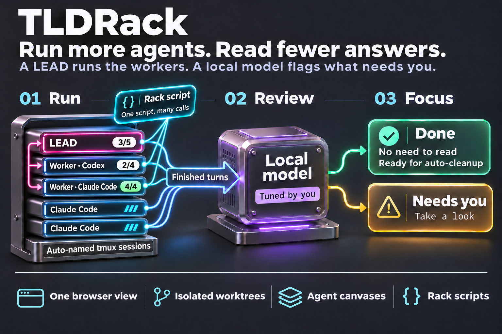
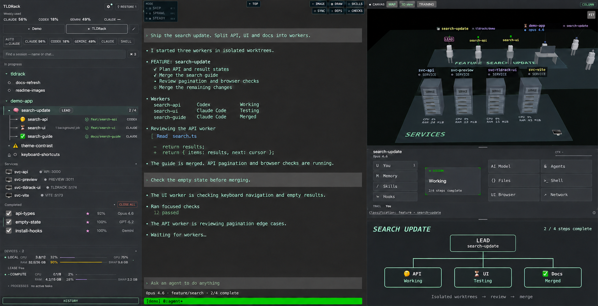
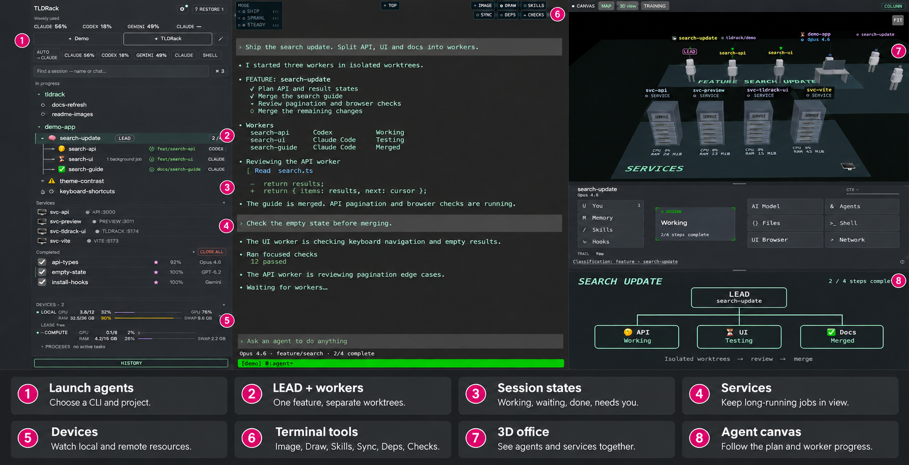
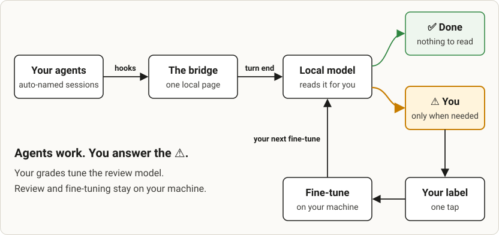
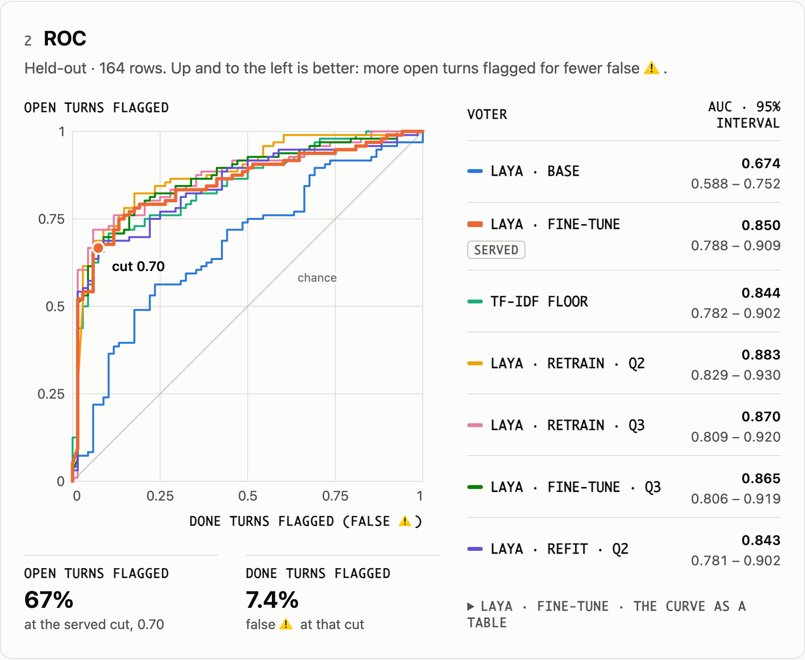
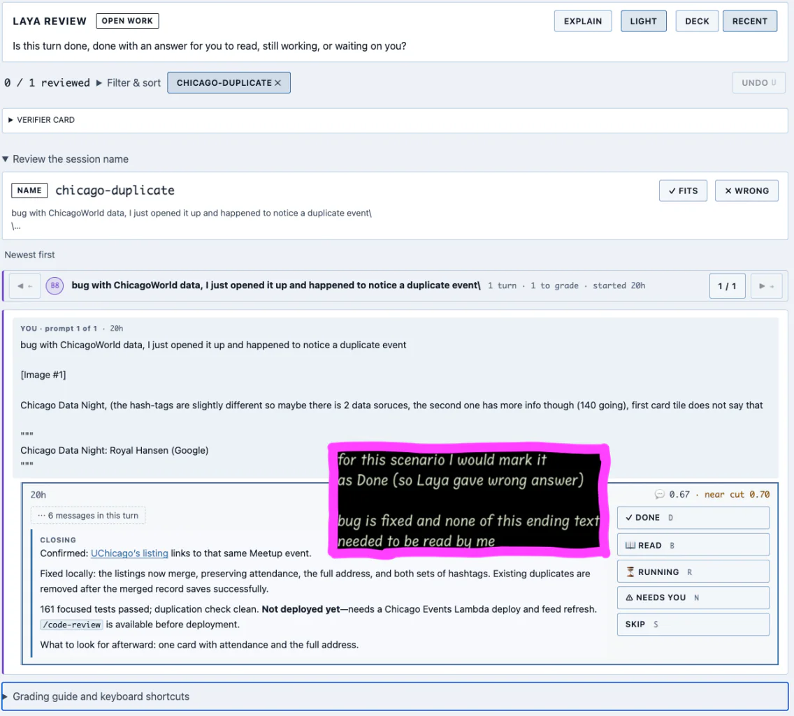
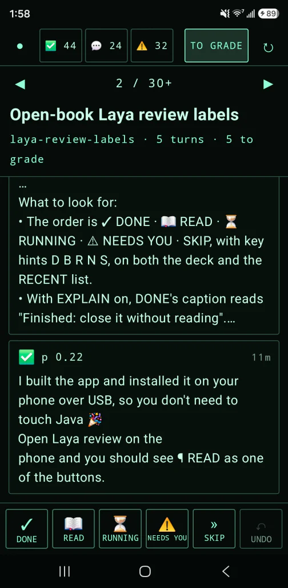

<h1><a href="docs/images/tldrack-lockup.webp"></a></h1>

Run coding agents side by side in tmux. One browser page shows the rack; a local model marks
finished turns ✅ done or ⚠️ needs you.

<p align="center">
  <a href="docs/images/tldrack-infographic-v4.webp"></a>
</p>

<table>
  <tr><th>TLDRack</th><th>TLDRack · annotated</th></tr>
  <tr>
    <td align="center"><a href="docs/img/readme/rack-demo-edited.webp"></a></td>
    <td align="center"><a href="docs/img/readme/rack-annotated-edited.webp"></a></td>
  </tr>
  <tr><th>THE LOOP</th><th>ROC · local model review</th></tr>
  <tr>
    <td align="center"><a href="docs/architecture.svg"></a></td>
    <td align="center"><a href="docs/evals/figures/roc.light.png"><picture>
      <source media="(prefers-color-scheme: dark)" srcset="docs/evals/figures/roc.dark.png">
      
    </picture></a></td>
  </tr>
</table>

Edited screenshots show demo content and configured host controls; rack scripts are planned.
[Image workflow](.claude/skills/readme-images/SKILL.md) · [ROC methods and caveats](docs/VERIFIER.md).

<details>
<summary><b>Laya review · desktop and Android</b></summary>

<table>
  <tr><th>Desktop</th><th>Android</th></tr>
  <tr>
    <td align="center"><a href="docs/img/laya-review-desktop.webp"></a></td>
    <td align="center"><a href="docs/img/laya-review-android.webp"></a></td>
  </tr>
</table>

</details>

## Quickstart (macOS)

You need git, tmux, ttyd, Node 22.18+, uv, and a logged-in Claude Code or Codex CLI.
macOS is tested; Linux is not yet. Laya needs about 2 GB of disk and is optional.

```bash
brew install tmux ttyd node uv
curl -fsSL https://claude.ai/install.sh | bash   # skip if you already have Claude Code or Codex
claude                                           # log in once, then /exit
```

```bash
git clone https://github.com/voidcraft-world/tldrack
uv tool install --editable ./tldrack/bridge   # puts `tldrack` on your PATH, running from this checkout
cd /path/to/your/project                      # new agents start in the directory you run `tldrack up` from
tldrack up                                    # builds the page the first time, then opens http://127.0.0.1:7682/
```

Open **Settings → SETUP** to install agent hooks and, optionally, Laya. Choose a project, then
**CLAUDE** or **CODEX → HERE** to start a session. Add projects under **Settings → Directories**.

<details>
<summary><b>Setup, updates and troubleshooting</b></summary>

No Homebrew of your own (or one another account owns)? uv has its own installer:
`curl -LsSf https://astral.sh/uv/install.sh | sh`. tmux, ttyd and Node come from your package manager, and
another account's Homebrew reaches your PATH with `eval "$(/opt/homebrew/bin/brew shellenv)"`.

If `tldrack` is not found, run `uv tool update-shell` and open a new terminal. If startup fails, run
`tldrack doctor`. For occupied ports, use `export TLDRACK_PORT=7781 TLDRACK_STATUS_PORT=7791`.

Settings is also at `http://127.0.0.1:7682/settings.html`. **SETUP** installs missing hooks and Laya;
**FEATURES → LITE** reduces resource use. **Directories** stores project paths and the default across
devices. Worktree and LEAD launches use the bridge’s startup repository; their buttons explain limits.

**SETUP → UPDATE** pulls `main`, rebuilds the page and restarts the bridge; agent sessions keep running.
Optional **Auto-update** checks every five minutes. **Update check** only adds a notification dot.
Updates require a clean checkout on `main` and only fast-forward.

`tldrack up` leaves a running rack alone. `tldrack kill` stops the rack and keeps tmux sessions alive.
The rack is for one operator on one machine and has no login; see [SECURITY.md](SECURITY.md).

</details>

## Reading the rack

Hover a row’s mark for its meaning.

| Mark | The row | Set by |
|:---:|---|---|
| 🙋 | **Needs you.** The agent asked a question, or wants a permission or a plan approved | the agent's hooks |
| 📖 | **Answer to read.** You asked a question and the turn looks done. Open the row to read it | Laya, and your prompt ending in `?` |
| ☑️📖 &nbsp; ✅📖 | **Answer read.** The same answer once you opened the row: the 📖 stays beside the check | Laya, once you open it |
| ✅ | **Work looks done**, reply not opened yet | Laya |
| ☑️ | **Work looks done**, reply seen. The row moves to COMPLETE | Laya, once you open it |
| 💬 | **Reply ready**, not opened yet. Laya is not sure the work is done, or no review model runs | the agent's hooks |
| ○ | **Idle.** You have seen the reply | the agent's hooks |
| 🆕 | **New session**, no prompt yet | the agent's hooks |
| ⏳ | **Background jobs still run** after the turn ended. Closing the session stops them | the bridge |
| 🤔 | **Working** | the agent's hooks |
| ◌ | **No status**: a plain shell, or an agent without hooks | — |
| 🖥️ | **Service**: a server you started from the rack, or a job that has ended | the rack |
| 🪫 | **Cut off by a usage limit** that still holds | the agent's hooks |
| 🔋 | **Cut off by a usage limit** that has reset: resume it | the agent's hooks |
| 🛑 | **Cut off by another API error** | the agent's hooks |
| 💀 | **Session gone**: tmux no longer has it | the bridge |

A row can carry one badge beside its mark:

| Marks | The row |
|:---:|---|
| 💬⚠️ &nbsp; ○⚠️ | **Work may remain.** Laya read the closing message as unfinished. Press ⚠️ to grade it: ⏸ not now, ✗ not open, ✓ still open |
| 💬⏳ &nbsp; ○⏳ | **Work is open, and it waits on this row's own child sessions**, not on you |
| 🤔🧱 &nbsp; ◌🧱 | **Stuck?** The same command failed 4 times this turn, or 20 minutes passed with no progress |

✅, ☑️ and 📖 never carry ⚠️: one closing message is either done or open. 🙋 and 💀 never carry a badge. A ⚠️ you
parked with ⏸ draws nothing until you next prompt that session.

## Local review

Laya reviews finished turns locally. Your grades tune it on your machine; 40 labels, with at least
10 of each kind, are enough for a first fine-tune. `tldrack laya status` shows your progress.

The ROC above compares voters on held-out turns. Most labels were model-written; the operator-graded
sample is smaller. The turns stay private; the reproducible public suite contains 200 invented cases.

<details>
<summary><b>What your labels buy</b>: the base model against each fine-tune, metric by metric</summary>

<p align="center">
  <picture>
    <source media="(prefers-color-scheme: dark)" srcset="docs/evals/figures/labels-buy.dark.png">
    
  </picture>
</p>

</details>

[Results and caveats](docs/VERIFIER.md) · [Reproduce](docs/REPRODUCE.md) ·
[Model card](docs/MODEL_CARD.md) · [All evals](docs/evals/)

## What is optional

Everything below is off until you turn it on. **Settings → FEATURES** has the switch for each, and
`tldrack doctor` lists them in the terminal.

| | Adds | Turn on |
|---|---|---|
| **Ollama** | a local model suggests the next step for a finished session | Settings → FEATURES → Next step |
| **ntfy** | a push to your phone when an agent has waited on you a while | `tldrack notify --init` once, then its switch in Settings |
| **An Android phone** | grade Laya's verdicts from the phone, over USB | [`android/README.md`](android/README.md) |

## Where to read next

- [`bridge/README.md`](bridge/README.md): ports, where files go, optional parts, plugins.
- [`plugins/README.md`](plugins/README.md): what each plugin adds and which are on by default.
- [`plugins/laya/README.md`](plugins/laya/README.md): what Laya is, and how it learns from your grades.
- [`lab/README.md`](lab/README.md): the fine-tune, the golden suite, the bench.

## Credits

tldrack stands on excellent open-source work. [`docs/INSPIRATIONS.md`](docs/INSPIRATIONS.md) names the
projects it learned from, and [`NOTICE`](NOTICE) the ones it contains.

The logo was rendered with [Afterglyph](https://github.com/winchxyz/afterglyph) by winchxyz
([MIT license](docs/images/LICENSE.afterglyph)).

## License

MIT. See [`LICENSE`](LICENSE).
