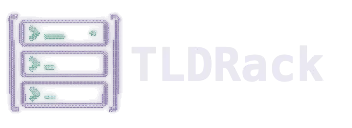
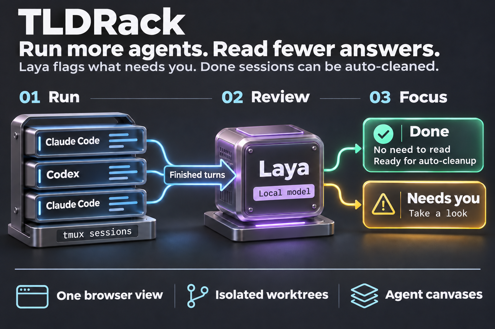
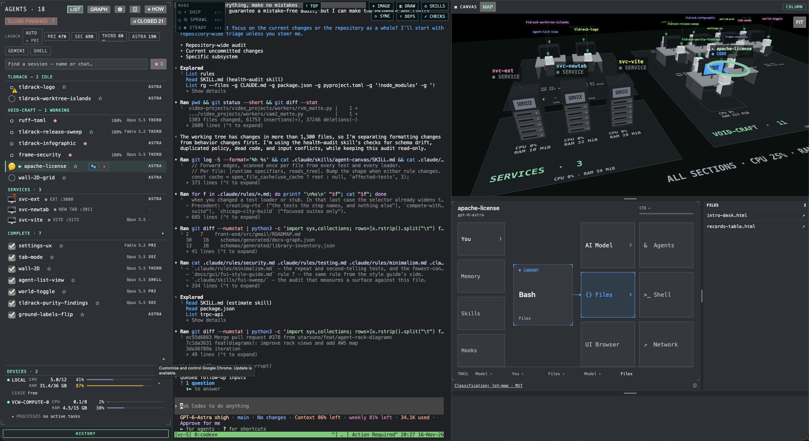
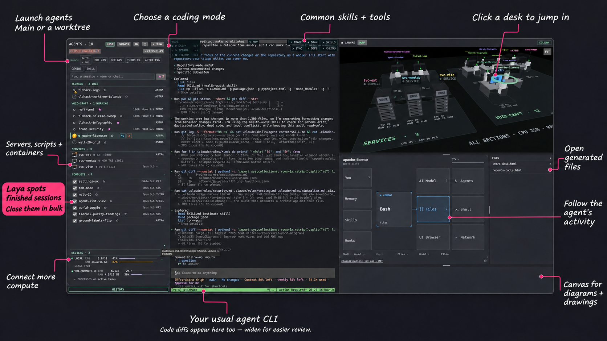
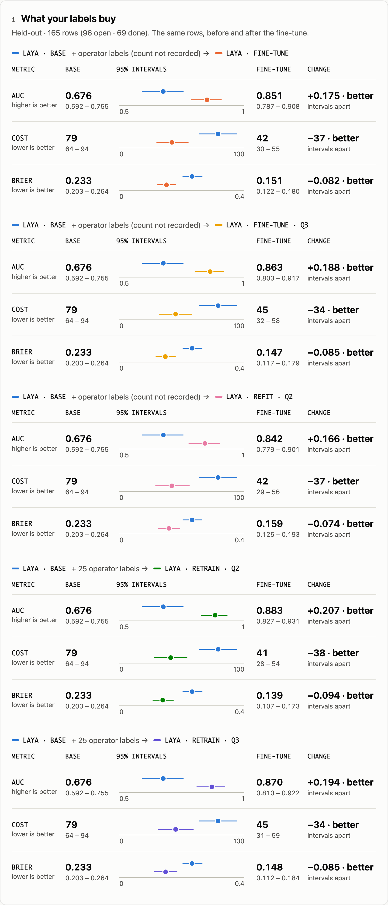

<h1><a href="docs/images/tldrack-lockup.webp"></a></h1>

tldrack runs your coding agents side by side in tmux and shows every one of them on one local page. When
a turn ends, Laya, a small model on your own machine, reads it for you and marks it ✅ done or ⚠️ needs you.

| Overview | Live rack | Annotated tour |
|:---:|:---:|:---:|
| <a href="docs/images/tldrack-infographic.png"></a> | <a href="docs/img/rack.png"></a> | <a href="docs/img/rack-annotated.png"></a> |

Click an image to open it at full size.

## Quickstart (macOS)

You need git, tmux, ttyd, Node 22.18 or newer, uv, and one agent CLI (Claude Code or Codex) that you have
logged in to once.

```bash
brew install tmux ttyd node uv
curl -fsSL https://claude.ai/install.sh | bash   # skip if you already have Claude Code or Codex
claude                                           # log in once, then /exit
```

No Homebrew of your own (or one another account owns)? uv has its own installer:
`curl -LsSf https://astral.sh/uv/install.sh | sh`. tmux, ttyd and Node come from your package manager, and
another account's Homebrew reaches your PATH with `eval "$(/opt/homebrew/bin/brew shellenv)"`.

Then, from wherever you keep code. It takes about ten minutes, and most of that is downloads:

```bash
git clone https://github.com/voidcraft-world/tldrack
cd tldrack
uv tool install --editable ./bridge   # puts `tldrack` on your PATH, running from this checkout
tldrack doctor                        # what this machine has; every missing part prints its fix
tldrack hooks --install               # your agent CLIs report their state to the rack
cd /path/to/your/project              # new agents start in the directory you run `tldrack up` from
tldrack up                            # builds the page the first time, then opens http://127.0.0.1:7682/
tldrack laya install                  # Laya's runtime and base model (about 800 MB), then serves it
```

If your shell says `tldrack: command not found`, run `uv tool update-shell` and open a new terminal. If
`tldrack doctor` says port 7681 or 7682 is taken (another rack on this machine, perhaps another account's),
give this one its own ports in that shell, then carry on:
`export TLDRACK_PORT=7781 TLDRACK_STATUS_PORT=7791`.

In the rack's **LAUNCH** row, press **CLAUDE** (or **CODEX**), then **HERE** (or **MAIN** on an older bridge). A terminal opens with the
agent in it: give it a task. When its turn ends, the row shows Laya's verdict: ✅ done, or ⚠️ it needs you.

Use **Settings → Directories** to add project names and absolute paths (or `~/…`), choose
one default, and save. The project buttons above **LAUNCH** choose where the next regular
agent starts; a fresh page uses the saved default. These settings belong to the bridge, so
other devices see the same directories. Worktree and LEAD launches remain tied to the bridge's
startup repository; their buttons explain when the selected project cannot use them.
Settings also holds the list/graph view, office, diagram and terminal appearance. **Close finished**
sits with the finished sessions.

`tldrack up` is safe to run again at any time: a rack that is already up is left alone. `tldrack kill` stops
it, and your agent sessions keep running in tmux.

## The loop

<p align="center">
  
</p>

- **Your agents work.** Each one is a tmux session running Claude Code or Codex. Its own hooks tell the
  bridge what it is doing: working, waiting on you, or done. Watching the rack costs no tokens.
- **Laya reads.** Laya is a 421M-parameter encoder, not a chatbot. It reads the closing message of a turn
  and answers one question: is work still open? No cloud call, no API key.
- **You answer the ⚠️.** The rack marks the rows that need you. The rest stay quiet until you want them.
- **You grade, and Laya learns.** Grade a verdict with one tap, in the rack, in the review deck or on your
  phone. Your grades fine-tune Laya on your machine, and a new checkpoint serves only after it beats the
  one before it.

You start on the public base model. Out of the box it is cautious: it marks most turns ✅ and misses some
that needed you. Your grades are what fix that. 40 of them, at least 10 of each kind, are enough for a first
fine-tune, and `tldrack laya status` counts them. The fine-tune is yours: it trains on your turns and never
leaves your machine.

## Reading the rack

Every row carries one mark. Hover it for the sentence.

| Mark | The row | Set by |
|:---:|---|---|
| 🙋 | **Needs you.** The agent asked a question, or wants a permission or a plan approved | the agent's hooks |
| 📖 | **Answer to read.** You asked a question and the turn looks done. Open the row to read it | Laya, and your prompt ending in `?` |
| ✅ | **Work looks done**, reply not opened yet | Laya |
| ☑️ | **Work looks done**, reply seen. The row moves to COMPLETE | Laya, once you open it |
| 💬 | **Reply ready**, not opened yet. Laya is not sure the work is done, or no review model runs | the agent's hooks |
| ○ | **Idle.** You have seen the reply | the agent's hooks |
| 🆕 | **New session**, no prompt yet | the agent's hooks |
| ⏳ | **Background jobs still run** after the turn ended. Closing the session stops them | the bridge |
| 🤔 | **Working** | the agent's hooks |
| ◌ | **No status**: a plain shell, or an agent without hooks | — |
| 🖥️ | **Service**: a server you started from the rack, or a job that has ended | the rack |
| 🪫 | **Cut off by a usage limit** that still holds | the agent's hooks |
| 🔋 | **Cut off by a usage limit** that has reset: resume it | the agent's hooks |
| 🛑 | **Cut off by another API error** | the agent's hooks |
| 💀 | **Session gone**: tmux no longer has it | the bridge |

A row can carry one badge beside its mark:

| Marks | The row |
|:---:|---|
| 💬⚠️ &nbsp; ○⚠️ | **Work may remain.** Laya read the closing message as unfinished. Press ⚠️ to grade it: ⏸ not now, ✗ not open, ✓ still open |
| 💬⏳ &nbsp; ○⏳ | **Work is open, and it waits on this row's own child sessions**, not on you |
| 🤔🧱 &nbsp; ◌🧱 | **Stuck?** The same command failed 4 times this turn, or 20 minutes passed with no progress |

✅, ☑️ and 📖 never carry ⚠️: one closing message is either done or open. 🙋 and 💀 never carry a badge. A ⚠️ you
parked with ⏸ draws nothing until you next prompt that session.

## Measured, not promised

The same held-out turns, one curve per voter. Up and to the left is better.

Claude Opus 5.5 is on the chart as a reference: a frontier cloud model, asked the same question with no
training. Most of these held-out labels were written by a Claude model, so its curve is partly Claude
agreeing with Claude. On the 37 turns the operator graded by hand, it and the fine-tune tie (AUC 0.77
against 0.74, the difference well inside the interval), and Opus is several times slower per verdict.

<p align="center">
  <picture>
    <source media="(prefers-color-scheme: dark)" srcset="docs/evals/figures/roc.dark.png">
    
  </picture>
</p>

<details>
<summary><b>What your labels buy</b>: the base model against each fine-tune, metric by metric</summary>

<p align="center">
  <picture>
    <source media="(prefers-color-scheme: dark)" srcset="docs/evals/figures/labels-buy.dark.png">
    
  </picture>
</p>

</details>

- [`docs/VERIFIER.md`](docs/VERIFIER.md): every number, with its row count, its interval and its caveats.
- [`docs/REPRODUCE.md`](docs/REPRODUCE.md): one command re-runs the public suite on your machine.
- [`docs/MODEL_CARD.md`](docs/MODEL_CARD.md): what Laya is for, and what it is not for.
- [`docs/evals/`](docs/evals/): the whole evals page. Open `docs/evals/index.html` from your clone.

The held-out turns are the operator's own and stay private: only aggregates are in this repository. The
public suite is 200 invented cases, and anyone can run it.

## What you need

| | |
|---|---|
| **macOS** | Linux is not tested yet |
| **git, tmux, ttyd** | every agent is a tmux session, and ttyd puts its terminal on the page |
| **Node 22.18 or newer** | builds the page, once |
| **uv** | installs the `tldrack` command and Laya's runtime |
| **An agent CLI** | Claude Code or Codex, logged in. One is enough |
| **About 2 GB of disk** | Laya's runtime and base model. Skip `tldrack laya install` and the rack still runs, without verdicts |

tldrack is for one person on their own machine: it has no login. [`SECURITY.md`](SECURITY.md) says what
it trusts, and what 0.1 does not close yet.

## What is optional

Everything below is off until you turn it on. `tldrack doctor` lists each part and how to switch it on.

| | Adds | Turn on |
|---|---|---|
| **Ollama** | a local model suggests the next step for a finished session | `tldrack next-step --mode shadow` |
| **ntfy** | a push to your phone when an agent has waited on you a while | `tldrack notify --init` |
| **An Android phone** | grade Laya's verdicts from the phone, over USB | [`android/README.md`](android/README.md) |

## Where to read next

- [`bridge/README.md`](bridge/README.md): ports, where files go, optional parts, plugins.
- [`plugins/README.md`](plugins/README.md): what each plugin adds and which are on by default.
- [`plugins/laya/README.md`](plugins/laya/README.md): what Laya is, and how it learns from your grades.
- [`lab/README.md`](lab/README.md): the fine-tune, the golden suite, the bench.

## Credits

tldrack stands on excellent open-source work. [`docs/INSPIRATIONS.md`](docs/INSPIRATIONS.md) names the
projects it learned from, and [`NOTICE`](NOTICE) the ones it contains.

The logo was rendered with [Afterglyph](https://github.com/winchxyz/afterglyph) by winchxyz
([MIT license](docs/images/LICENSE.afterglyph)).

## License

MIT. See [`LICENSE`](LICENSE).
