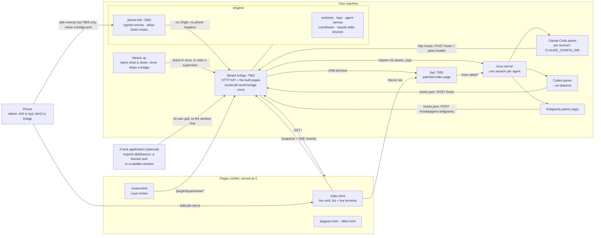
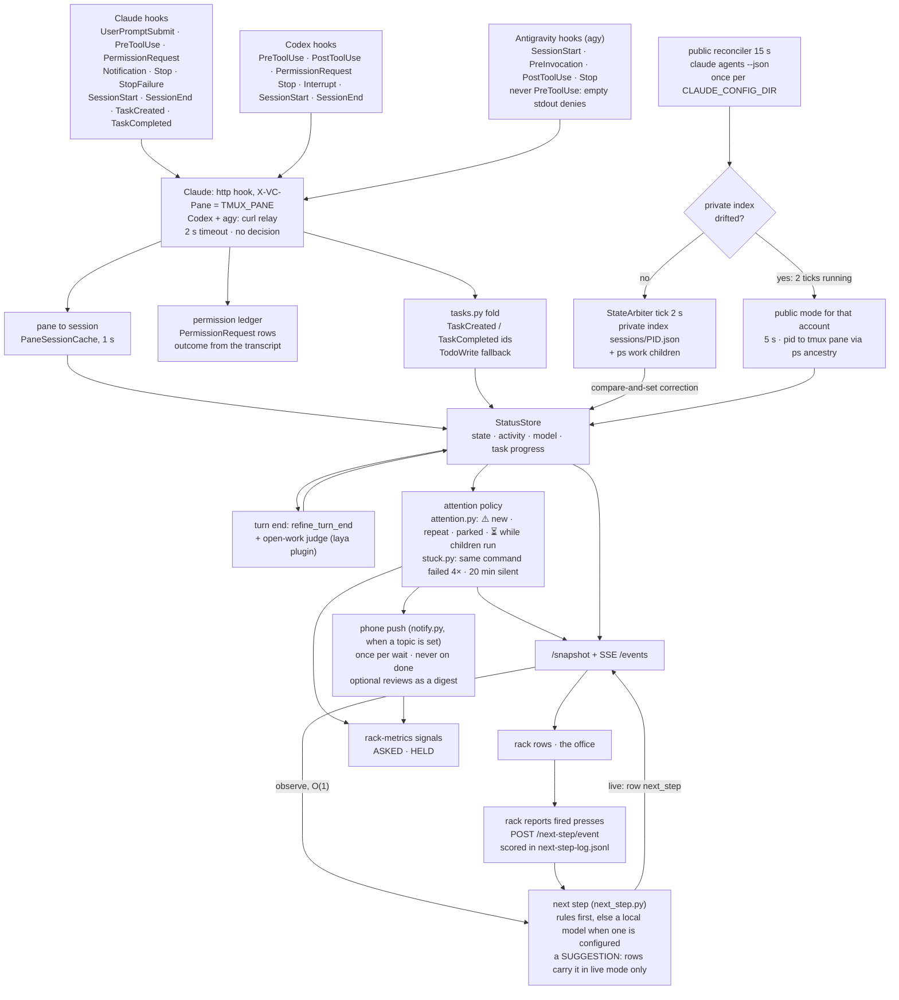
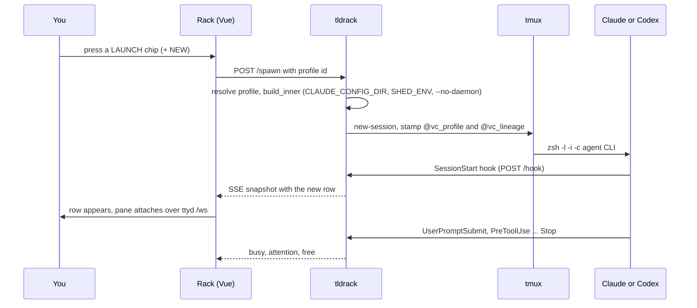
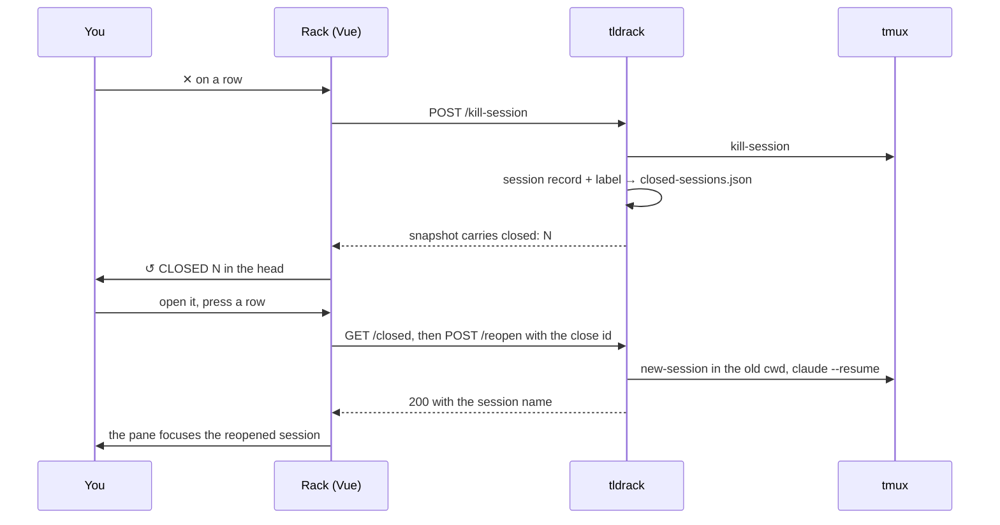
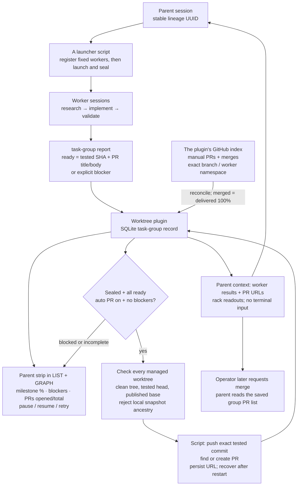
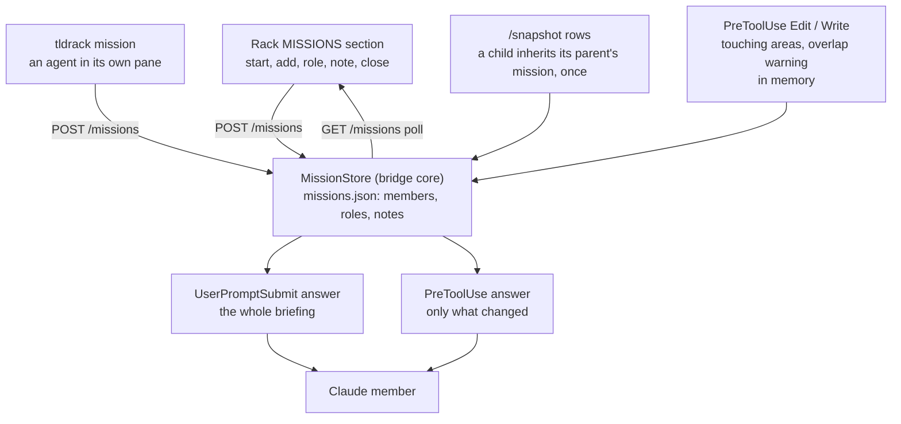
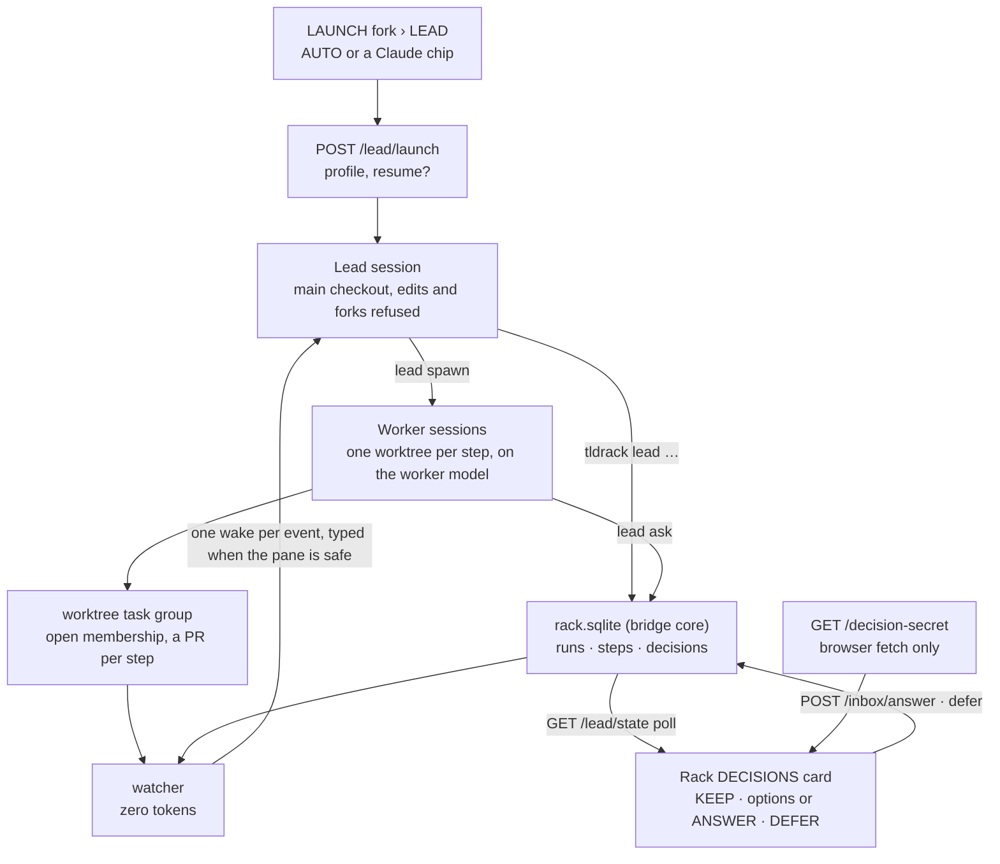
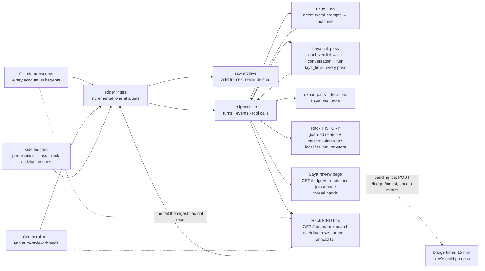
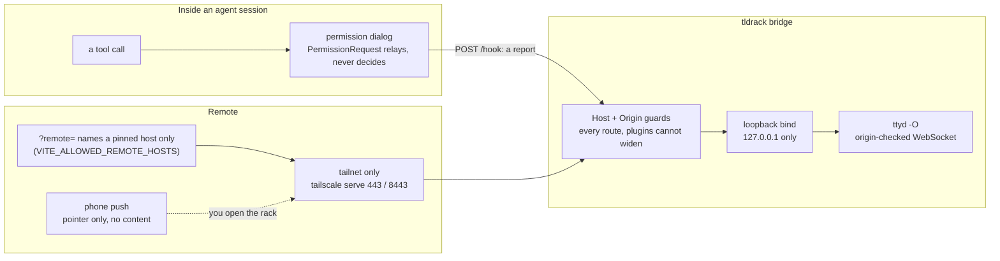

# How the agent rack works

<!-- The page behind the rack's ⌗ HOW button (AgentRackDiagram.vue) renders one tab per `## `
     section. This file is the diagram's ONE owner: add a plugin, a route or a hook to the rack
     and it goes here too. tests/unit/agent-rack-diagram.test.ts fails while a directory of
     plugins/ is missing from the Topology tab. -->

## Topology

Who starts what. Everything runs on your machine except the phone; nothing here is a cloud service.

## Status pipeline

How one row decides busy / attention / free. Hooks are fast but miss things (Esc fires no hook);
the arbiter and the public CLI catch what they miss.

## Launch

What happens between pressing a LAUNCH chip and a live row. Settings reads and writes
`/launch-directories`; a regular `/spawn` carries the selected saved `cwd`.
The directory contract: `bridge/tldrack/launch_directories.py`.

## Close and reopen

A ✕ is one click, so it has an undo. The record a close drops lands on the bridge's closed list, and ↺ CLOSED brings one back where it was, conversation and all.

## Parent task groups

The parent keeps the task context. The worktree plugin counts reported milestones and publishes PRs without an LLM monitor.
The percentage measures milestones, not time. PRs have a separate opened/total count. Merging requires a later request.

## Missions

A mission is agents assigned to one task. The bridge tells each member who else is on it and where they are
working, through its hooks. Nothing is typed into a pane, and no LLM runs.

## Lead

A LEAD runs a planned feature through worker sessions and never does the work itself. The
bridge watches the workers at zero tokens and wakes the lead once per event. Only the operator answers a
decision, from the rack's DECISIONS card.

## Session ledger

Every conversation kept past the agent CLI's own cleanup, and the human decisions in it as rows. It
reads the transcripts on this machine into the bridge's data directory. Nothing leaves the machine.

## Safety

Rack interaction history: `AgentRackComponent` → `metric` transport action → guarded
`POST /rack-metrics/event` → local `rack-metrics.sqlite`. `GET /rack-metrics` reads it back; settings
and experiment markers use `/rack-metrics/settings`.

Suggested next step: `AgentRackComponent` → `next_step` transport action (a REPORT, never an act) →
guarded `POST /next-step/event` → `next-step-log.jsonl`. [DO IT] presses the row's own control, so its
arm and refusals still run. `GET /next-step` reads the state and `POST /next-step/settings` switches
the mode.

Settings: `settings.html` reads `GET /doctor` (the checks `tldrack doctor` prints, as JSON) and
`GET /features`, and writes guarded `POST /features` → `features.json`. A switch can only turn a part of
this bridge off or back on, never name a path or load code: `bridge/tldrack/features.py`. What one browser
draws (the 3D office, motion) stays in that browser: `ui/src/config/rack-prefs.ts`.

Launch defaults: `GET/POST /profile-launch-settings`, owned by `bridge/tldrack/profile_launch_settings.py` — see the note there.

Update: the rack's ⚙ dot and the Settings UPDATE card read `GET /update` (the checkout against its
remote, the page against the checkout, the running code against the disk). Guarded
`POST /update {"action"}` fetches, or fast-forwards the checkout, rebuilds `ui/dist` and restarts the
bridge in place. The request names an action and nothing else: `bridge/tldrack/update.py`.

What is guarded, and where. Hooks only report; deciding stays with you or a deterministic rule.

